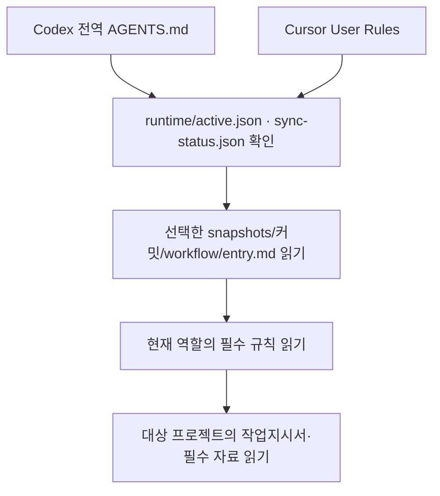

# AI Workflow

Codex와 Cursor에서 공유하는 단계별 에이전트 운영 규칙입니다. 개정 `2026-11-08`, 프로젝트 관리 구조 버전 `5`를 기준으로 분리했습니다.

전역 지침에는 짧은 연결 문구만 넣고, 에이전트는 역할별 필수 문서를 읽습니다. 공통 파일 준비와 도구 연결을 실제 사용하는 PC·실행 환경마다 한 번 수행하며 프로젝트마다 규칙을 복사하지 않습니다. 프로젝트별 작업 기록은 기존처럼 `.ai-work/`에 두고 Git에서 제외합니다.

## 전체 연결 구조

기본 설치 위치는 홈 디렉토리의 `.ai-workflow`입니다. `source/`에는 Git에서 clone한 원본과 관리 스크립트가, `runtime/`에는 동기화한 버전별 사본과 도구에 등록할 연결 지침이 생깁니다. 실행 파일을 시스템에 설치하는 패키지가 아니라 로컬 문서와 Python 스크립트를 준비하는 방식입니다.

| 위치 | 역할 |
|---|---|
| `source/` | 규칙·가이드·설치 도구의 Git clone |
| `runtime/snapshots/<커밋>/` | 에이전트가 읽을 고정 버전의 문서·도구 묶음 |
| `runtime/active.json` | 새 작업에서 읽을 스냅샷과 `entry.md`의 절대 경로 |
| `runtime/sync-status.json` | 마지막 원격 확인의 성공·실패와 시각 |
| `runtime/connectors/codex.md`, `cursor.md` | 각 도구의 전역 지침에 넣을 짧은 연결 문구 |

연결 지침에는 해당 PC의 `active.json` 절대 경로가 들어갑니다. 도구에 이 내용을 등록하면 에이전트가 다음 순서로 파일을 읽습니다.



전체 규칙이 자동 첨부되는 방식은 아닙니다. 에이전트가 연결 지침을 따라 파일 읽기 도구로 접근하므로, 해당 실행 환경에서 로컬 경로를 읽을 수 있어야 합니다. 새 작업은 선택한 커밋을 고정하고, 진행 중인 작업은 동기화 후에도 기존 버전을 유지합니다.

## 설치 순서

| 단계 | 수행할 일 | 완료 결과 |
|---|---|---|
| 1. 공통 파일 준비 | 사용할 환경에서 clone → `sync` → `render` 실행 | `source/`와 `runtime/` 준비 |
| 2. 도구 연결 | Codex는 `install-codex`, Cursor는 `cursor.md` 내용을 User Rules에 붙여넣기 | 도구가 문서 위치를 알 수 있음 |
| 3. 연결 확인 | 각 도구의 새 대화에서 실제 경로·커밋·파일 읽기 확인 | 해당 환경의 연결 동작 확인 |
| 4. 프로젝트 사용 | 사용자 가이드의 단계별 요청 실행 | 역할에 필요한 규칙으로 작업 |

- 공통 준비: [Windows PowerShell](docs/installation.md#windows-powershell) 또는 [Bash / WSL / Linux / macOS](docs/installation.md#bash--wsl--linux--macos) 중 실제 실행 환경을 선택합니다. 이미 clone했다면 설치 문서의 기존 저장소 재사용 예시를 사용합니다.
- 도구 등록: 사용하는 도구의 [Codex 연결](docs/installation.md#codex-연결)·[Cursor 연결](docs/installation.md#cursor-연결)을 진행합니다. 둘 다 사용하면 각각 등록합니다.
- 검증과 사용: [첫 연결 확인](docs/installation.md#첫-연결-확인) 후 [사용자 가이드](docs/user-guide.md)에 따라 단계를 요청합니다.

설치 예시의 `workflow_root`, `workflow_source`, `workflow_state`는 명령에 경로를 전달하는 셸 변수입니다. 영구 환경변수 등록은 필요 없으며 생성된 연결 지침에는 절대 경로가 기록됩니다. 새 터미널에서 관리 명령을 실행할 때만 변수를 다시 지정합니다.

## 구성

```text
AGENTS.md                  저장소 유지보수 지침
workflow/
  entry.md                 역할별 읽기 목록과 버전 고정
  common.md                요청 분류·권한·소유권·Git 제외·언어
  models.md                모델 배정·Sol 대체·실패 재시도
  records.md               프로젝트 구조·작업 상태·검증 기록
  quality.md               코드 품질·분야별 검증
  planning.md              계획
  execution.md             실행
  integration.md           통합
  orchestration.md         총괄
  user-validation.md       사용자검증
  commit-list.md           커밋목록
  migration.md             필요한 경우의 구조 전환
  dashboard.md             별도 요청한 현황판
docs/                      설치·운영·사용자 가이드
templates/                 도구별 연결 문구를 만드는 공통 템플릿
scripts/                   동기화·설치·문서 검사
examples/                  커밋리스트 예시
tests/                     배포·설치 보존 시험
manifest.json              배포 스키마·개정·진입 파일
```

`AGENTS.md`는 이 저장소를 수정하는 에이전트용입니다. PC 전역에는 이 파일 대신 `render`로 생성한 연결 지침을 넣습니다. 일반 작업에서 README·가이드·전체 규칙을 한꺼번에 읽지 않습니다.

## 유지하는 운영 기준

- 최초 모델: 계획 3단계, 총괄·통합 2단계, 실행·사용자검증·커밋목록 1단계.
- 실행·통합은 동일 문제에서 지정 모델로 최초 시도 포함 2회 실패한 뒤 바로 위 단계로 1회만 시도합니다. 다시 실패하면 중단·보고합니다.
- 총괄은 계획의 병렬 가능 판단과 현재 조건을 확인해 독립 작업을 병렬 배정합니다.
- 실행·통합이 병렬 수행 불가를 발견하면 영향받는 작업을 보류하고 총괄 지시를 따릅니다.
- 최종 수락은 통합 담당자가 판단합니다. 커밋목록은 텍스트만 작성하며 실제 staging·commit을 수행하지 않습니다.

## 배포 기준

이 저장소의 원격 `main`을 최신 승인본으로 사용합니다. `sync`는 원격을 fetch한 뒤 해당 커밋 전체를 별도 폴더에 추출합니다. 소스 checkout을 pull하거나 프로젝트 파일을 변경하지 않습니다. 검증이 끝나면 `active.json`을 갱신하며, 기존 작업과 하위 에이전트는 이미 고정한 커밋을 유지합니다.

동기화 실패·오프라인 사용을 최신 확인 성공으로 표시하지 않습니다. 자동 호출은 전역 지침을 따르는 에이전트의 실행이며 OS의 상시 동기화 서비스나 앱 hook을 설치하지 않습니다. 확실한 시작 전 갱신이 필요하면 설치 안내의 명령을 직접 실행합니다.

## 검사와 개정

```bash
python3 scripts/check_docs.py
python3 -m unittest discover -s tests -v
```

개정·버전 고정·문서 분리 대응표는 [유지보수 안내](docs/maintenance.md)를 참고하세요. 모델 계열의 버전 기준일은 `2026-11-07`이며 문서 개정일과 별개입니다. 현재 환경의 실제 모델 가용성은 배정 시 확인합니다.
