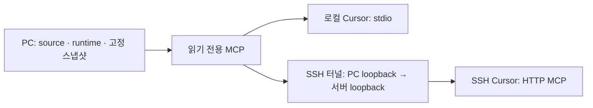

# PC 한 곳의 워크플로우를 Cursor MCP로 읽기

개정: 2026-11-10

워크플로우 저장소와 runtime은 PC 한 곳에서 관리하고, Cursor가 MCP 도구로 필요한 원문만 읽습니다. SSH 서버마다 레포를 clone하거나 Python·Git·워크플로우 도구를 설치하지 않습니다. 프로젝트 코드와 `.ai-work/` 기록은 기존 서버에 둡니다.

Cursor의 User Rules는 문서를 어디서 읽을지 알려 주는 연결 지침입니다. MCP 설정은 실제 읽기 통로입니다. 둘 다 연결해야 합니다. 이 기능은 Python 표준 라이브러리만 사용하며 기존 파일 경로 방식과 Codex 설정도 유지합니다.

## 연결 방식 선택

| 작업 환경 | 연결 |
|---|---|
| Windows 로컬 작업 | stdio: Cursor가 Windows Python으로 MCP 실행 |
| Remote SSH·WSL·컨테이너 등 PC 경로를 직접 못 읽는 환경 | PC의 HTTP MCP에 연결. 아래 SSH 터널은 Remote SSH 예시 |



서버에는 MCP URL·인증 토큰을 담은 작은 연결 설정이 필요할 수 있습니다. Remote SSH에서 stdio를 등록하면 원격 호스트에서 명령이 시작될 수 있으므로 Windows Python 경로를 원격 stdio 설정에 넣지 않습니다. 로컬에서 등록한 MCP가 모든 원격 창에 자동 전달된다고 가정하지 말고, **사용할 SSH 창의 MCP 목록**에서 확인합니다. 여러 서버가 각각 같은 PC MCP에 연결하며 문서 갱신은 PC에서만 수행합니다.

## 1. PC에서 MCP 연결 자료 준비

먼저 [공통 설치](installation.md)의 sync를 끝내 runtime의 active.json이 있어야 합니다. MCP를 추가하려고 기존 clone·runtime을 다시 만들 필요는 없습니다. 소스 도구가 구버전이면 로컬 수정 여부를 확인한 뒤 원격에 반영된 MCP 지원 버전을 받습니다. 미커밋 수정은 일반 sync로 배포되지 않습니다.

아래는 기본 위치에 설치한 **Windows PowerShell** 예시입니다. 기존 source가 다른 곳에 있다면 `$workflowSource`만 실제 위치로 바꿉니다.

```powershell
$workflowRoot = Join-Path $env:USERPROFILE '.ai-workflow'
$workflowSource = Join-Path $workflowRoot 'source'
$workflowState = Join-Path $workflowRoot 'runtime'
py -3 "$workflowSource/scripts/workflow.py" prepare-mcp --state-dir $workflowState
if ($LASTEXITCODE -ne 0) { throw 'prepare-mcp failed' }
```

출력은 생성한 파일 경로만 보여 주며 토큰 본문을 출력하지 않습니다.

| 생성 파일 | 용도 |
|---|---|
| `runtime/mcp-token` | HTTP 인증 토큰. 재실행해도 유지 |
| `runtime/connectors/cursor-mcp-stdio.json` | 로컬 Windows Cursor에 등록할 설정 조각 |
| `runtime/connectors/cursor-mcp-http.json` | HTTP MCP에 등록할 설정 조각. 인증 토큰 포함 |
| `runtime/connectors/cursor-mcp.md` | User Rules에 넣을 MCP 연결 지침 |

토큰·HTTP 설정은 비밀정보입니다. Unix에서는 새 토큰·JSON·백업 파일을 권한 0600으로 만들며, Windows에서는 사용자 폴더의 ACL을 확인합니다. 이 파일들은 제품 저장소에 커밋하거나 채팅에 붙이지 않습니다. 생성 JSON은 **전체 설정의 대체 파일이 아니라 `ai-workflow` 항목을 담은 조각**입니다.

## 2. 로컬 Cursor 연결

Windows 로컬 창에서 사용할 경우 PC의 설정에 stdio를 등록합니다.

```powershell
py -3 "$workflowSource/scripts/workflow.py" install-cursor-mcp --state-dir $workflowState --transport stdio
if ($LASTEXITCODE -ne 0) { throw 'install-cursor-mcp failed' }
Get-Content -Raw "$workflowState/connectors/cursor-mcp.md"
```

설치 명령은 실행한 Python 환경의 `~/.cursor/mcp.json`에 `ai-workflow` 항목을 추가·갱신하고 다른 MCP·최상위 설정을 보존합니다. 기존 파일 변경 전 `mcp.json.bak-<고유값>`으로 원래 바이트를 백업하며 동일 설정이면 다시 쓰지 않습니다. 다른 설정 경로를 사용한다면 `--config '실제 mcp.json 절대 경로'`로 지정합니다. 잘못된 JSON·JSONC 주석·심볼릭 링크는 자동 수정하지 않고 중단합니다.

표시된 연결 지침을 Cursor **User Rules의 기존 워크플로우 연결 구역**과 교체합니다. 기존 경로 방식의 구역과 MCP 구역을 중복 등록하지 않고, 다른 사용자 지침은 보존합니다. User Rules는 스크립트가 자동 편집하지 않습니다.

Cursor의 MCP 목록에서 `ai-workflow`를 활성화합니다. 필요하면 Cursor를 재시작합니다. 로컬 stdio는 Cursor가 프로세스를 관리하므로 별도 HTTP 서버를 켜지 않아도 됩니다.

## 3. Remote SSH 연결

### PC의 MCP 실행

위 1단계를 마친 PC의 PowerShell에서 실행합니다. 이 터미널은 열어 둡니다.

```powershell
py -3 "$workflowSource/scripts/workflow_mcp.py" --state-dir $workflowState --transport http
```

기본 주소는 `http://127.0.0.1:8765/mcp`입니다. MCP는 PC의 loopback에만 바인딩하고 인증 토큰이 있는 요청만 받습니다. 임의 PC 파일 읽기·명령 실행·sync·쓰기 도구는 제공하지 않습니다. 이 명령은 자동 시작 서비스나 방화벽 규칙을 설치하지 않습니다. `Ctrl+C`로 종료합니다.

### PC에서 서버로 SSH 터널 연결

**PC의 다른 PowerShell 터미널**에서 실제 SSH 별칭을 지정하고 실행합니다. 터널은 사용하는 서버마다 연결하며 이 터미널도 열어 둡니다.

```powershell
$workflowSshHost = 'my-server'
ssh -NT -o ExitOnForwardFailure=yes -o ServerAliveInterval=30 -R 127.0.0.1:8765:127.0.0.1:8765 $workflowSshHost
```

서버의 `127.0.0.1:8765`에 보낸 요청이 PC의 `127.0.0.1:8765`로 전달됩니다. 서버의 SSH 포트 전달 허용이 필요합니다. 서버에서 포트가 이미 사용 중이거나 전달이 금지되면 터널이 실패하므로 이 오류를 먼저 해결합니다. 여러 Cursor 창이 같은 서버를 사용하면 기존 터널 하나를 공유하고 같은 원격 포트에 중복 터널을 열지 않습니다.

원격 포트를 18765로 바꾸려면 `-R 127.0.0.1:18765:127.0.0.1:8765`를 사용하고, 1단계 prepare 명령에 `--url http://127.0.0.1:18765/mcp`를 추가해 해당 URL의 설정 조각을 생성합니다. PC MCP는 계속 8765로 실행합니다.

### 사용할 SSH 창에 HTTP MCP 등록

Cursor로 해당 SSH 서버의 코드 폴더를 열고 그 창의 MCP 설정에 `cursor-mcp-http.json`의 **`mcpServers.ai-workflow` 항목을 병합**합니다. 설정 파일을 통째로 덮어쓰지 않습니다. 원격 전역 설정 경로는 일반적으로 해당 사용자의 `~/.cursor/mcp.json`이고 프로젝트 범위 설정은 `.cursor/mcp.json`입니다. 개인 토큰은 프로젝트 공유 설정 대신 사용자 전역 설정에 둡니다.

PC에서 설정 조각은 다음처럼 열 수 있습니다. 이 명령은 토큰을 화면에 보여 주므로 공개 로그·채팅에 출력을 공유하지 않습니다.

```powershell
notepad "$workflowState/connectors/cursor-mcp-http.json"
```

User Rules에는 2단계와 같은 `cursor-mcp.md` 지침을 사용합니다. SSH 창에서 `ai-workflow`의 두 도구가 보이는지 확인하고 새 대화로 아래 검증을 수행합니다. PC에서 HTTP 연결을 직접 확인하려면 로컬 창에도 `install-cursor-mcp --state-dir $workflowState --transport http`로 등록할 수 있습니다. 이 명령은 그 설정의 기존 stdio 항목을 HTTP로 교체합니다.

서버에 필요한 것은 URL·토큰 설정과 SSH 터널뿐입니다. **서버별 clone·sync·Python MCP 설치는 하지 않습니다.** WSL·컨테이너는 PC loopback에 도달하는 방법이 다르므로 같은 주소가 통한다고 가정하지 않습니다. 터널 또는 인증·TLS를 제공하는 별도 연결 구성을 확인해야 합니다. 이 도구의 HTTP 서버를 인터넷에 직접 노출하지 않습니다.

## 4. 실제 연결 확인

사용할 로컬 창 또는 SSH 창의 **새 대화**에서 다음을 요청합니다. 경로나 MCP 지침 본문을 질문에 붙이지 않아야 자동 지침 로딩을 확인할 수 있습니다.

```text
프로젝트를 실행하지 말고 연결 확인만 해 줘.
자동으로 전달받은 지침에 ‘단계별 워크플로우 연결 (MCP)’이 있는지 확인해 줘.
없으면 없다고 보고하고 임의로 다른 경로를 찾지 마.
있으면 지침의 MCP로 상태를 읽고 선택한 커밋의 entry.md 본문을 읽어 줘.
사용한 MCP 도구, 호스트의 두 JSON 실제 경로, 고정 커밋과 snapshot_uri,
entry 본문 읽기 성공 여부와 실행 역할의 필수 문서 목록을 보고해 줘.
목록 확인과 필수 문서 본문 읽기를 구분하고,
기록된 원격 확인 시각과 이번 MCP 읽기 시각도 구분해 줘.
원격 동기화·프로젝트 실행·파일 변경은 하지 마.
```

도구는 다음 두 개뿐입니다.

| 도구 | 반환 내용 |
|---|---|
| `get_workflow_status()` | 실제로 읽은 active.json·sync-status.json 내용, 호스트 경로, 이번 관측 시각과 읽은 파일 목록. manifest도 검증하며 entry 본문은 아직 읽지 않음 |
| `read_workflow_document(commit, path)` | 지정한 고정 커밋의 Markdown 원문, 호스트 경로, 논리 URI, 읽기 시각, SHA-256 |

예를 들어 status의 커밋을 고정하고 `path="workflow/entry.md"`를 읽은 뒤 entry의 역할별 표에 있는 문서만 같은 커밋으로 읽습니다. 상대 링크 `common.md`는 `workflow/common.md`로 요청합니다. `docs/` 문서는 설치·설명 요청 시에만 읽습니다. 원격 프로젝트의 작업지시서는 기존 파일 읽기 도구로 읽습니다.

MCP는 지정한 runtime의 `workflow/`·`docs/` Markdown 문서만 제공합니다. 축약 커밋·브랜치 이름·임의 절대 경로·상위 경로·심볼릭 링크는 거부하고, 없는 고정 커밋을 최신 커밋으로 바꾸지 않습니다. 이 SHA-256은 읽은 본문의 식별값이며 Git 스냅샷 전체의 무결성 재검증을 대신하지 않습니다. 스냅샷 무결성 검증은 기존 sync가 담당합니다.

## 갱신·오류·검증 범위

- 규칙을 갱신할 때는 PC에서 기존 sync 명령을 실행합니다. 새 작업은 새 active를 선택하고 기존 작업은 고정 커밋을 유지합니다. MCP는 요청마다 파일을 읽으므로 문서 갱신만으로 서버 재시작은 필요 없습니다. MCP 도구 코드를 갱신하면 HTTP 프로세스를 재시작합니다.
- sync 실패는 sync-status.json에 남고 기존 active는 유지됩니다. MCP 관측 시각은 원격 확인 시각이 아닙니다. 최신 버전이 필수인데 원격 확인에 실패했다면 시작을 보류합니다.
- MCP가 보이지 않으면 그 창의 MCP 설정·활성 상태·MCP 로그를 확인합니다. 연결 거부·시간 초과면 PC 서버·SSH 터널·포트를, 401이면 URL에 대응하는 토큰을 확인합니다. 토큰을 자동 재발급하지 않습니다.
- 롤백은 해당 mcp.json의 백업을 검토해 복원하거나 `ai-workflow` 항목만 제거합니다. 다른 MCP는 보존합니다. User Rules는 기존 파일 경로 지침으로 되돌릴 수 있지만 그 환경에서 실제 경로 접근이 가능해야 합니다.
- 자동 시험은 실제 stdio 프로세스와 loopback HTTP의 초기화·도구 호출, 인증·경로 제한, 버전 고정과 설정 보존을 검사합니다. 실제 Windows Cursor의 User Rules 자동 로딩·SSH 터널·모델 전환 성공은 해당 PC에서 별도로 확인해야 합니다.

프로토콜은 [MCP Streamable HTTP·stdio 규격](https://modelcontextprotocol.io/specification/2025-11-25/basic/transports), 설정 형식은 [Cursor MCP 공식 안내](https://cursor.com/docs/mcp)를 따릅니다. 이 서버는 JSON 응답의 stateless Streamable HTTP이며 기존 SSE 전용 연결은 지원하지 않습니다.
